# CareBridge

CareBridge is a post-discharge care companion that helps patients follow their care instructions after leaving the hospital.

Patients upload their hospital discharge report. A Discharge Understanding Agent turns it into a structured care plan containing medications, appointments, daily tasks, questions to confirm with a clinician, and warning signs.

A Follow-up Agent supports patients at home through ongoing check-ins. Each safety assessment results in one of three outcomes: **monitor**, **review**, or **emergency**.

CareBridge does not diagnose conditions or change medication doses. Safety decisions are handled by deterministic Python rules, while the model explains the results in plain language.

The sample discharge is fictional. This is not a medical device and not a substitute for the care team.

## Screens

### 1. Home

| Going home | One report in | Upload, understand, follow |
| :---: | :---: | :---: |
|  |  |  |
| *The opening asks for a discharge report. The card beside it is an example layout, not a patient record.* | *Plain language, medicines, a calendar, a checklist, and gaps to confirm with a clinician.* | *Upload the report, the agents read it, then the patient follows a daily plan.* |

### 2. Upload

| Drop the discharge report | Scanning the file |
| :---: | :---: |
| 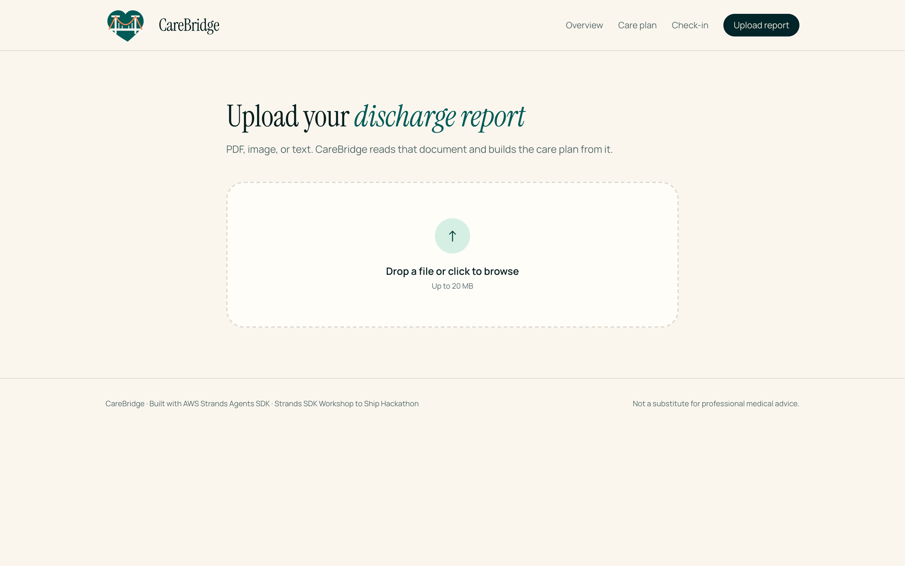 | 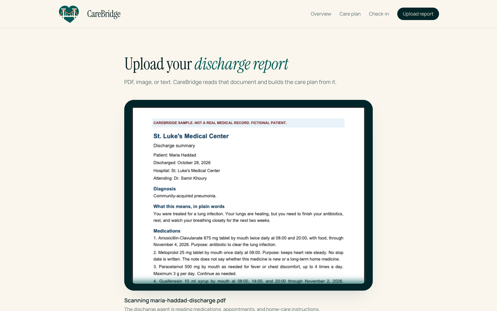 |
| *A PDF, image, or text file goes in this box. The limit is 20 MB.* | *The report stays on screen while it is read.* |

### 3. Care plan

| Medicines and today's tasks | Appointments and items to confirm |
| :---: | :---: |
| 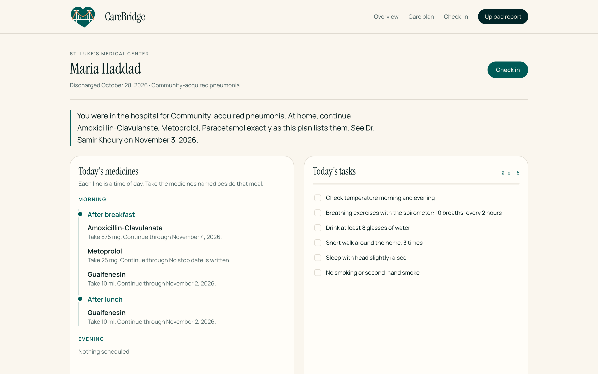 | 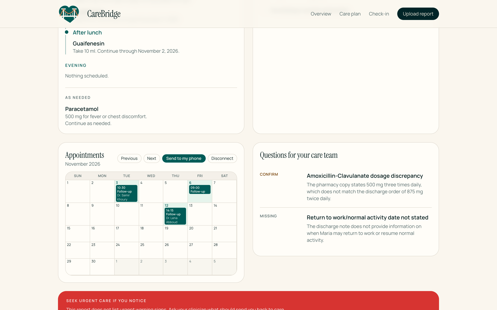 |
| *Medicines by time of day, and the tasks for today.* | *Follow-up visits on the month calendar, and the items still open for the care team.* |

### 4. Check-in

| A normal day | Pending |
| :---: | :---: |
| 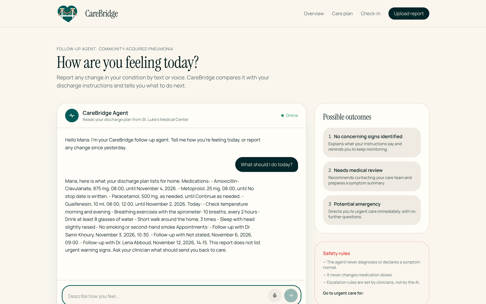 | 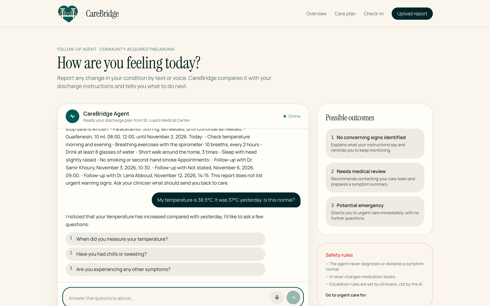 |
| *The agent retrieves today's medications, scheduled tasks, and appointments from the saved care plan.* | *The answer asks the follow-up questions and waits.* |

| Needs medical review | Potential emergency |
| :---: | :---: |
| 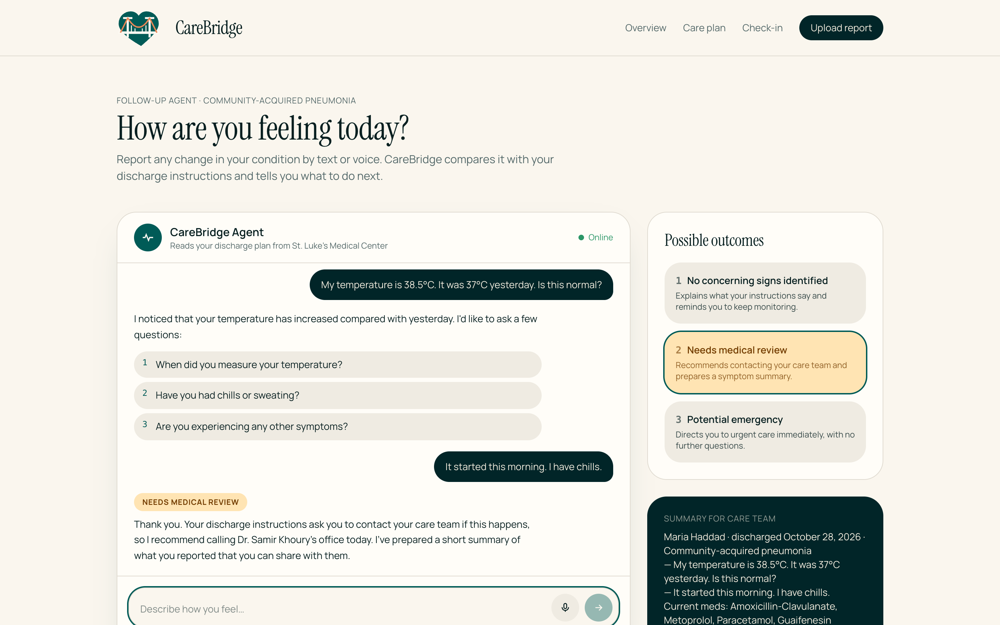 | 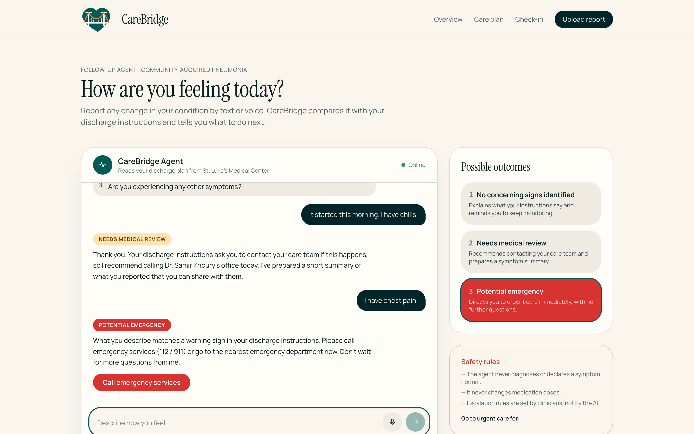 |
| *The answer says the check-in needs medical review and shows a summary for the care team.* | *The answer says to call emergency services.* |

## Architecture at a glance

- React frontend (`web/`): document upload, care plan, and patient check-ins.
- FastAPI (`api.py`): handles requests and coordinates the application workflow.
- Discharge Understanding Agent: extracts and structures information from discharge reports.
- Follow-up Agent: answers questions using the saved care plan.
- Safety specialist: evaluates symptoms through deterministic Python rules. It does not make a second model call.
- Amazon Bedrock: powers the Strands agents.
- Amazon S3: stores documents, plans, and session data when configured.
- Amazon Bedrock AgentCore: hosts the deployed agent runtime. The screens call FastAPI.

## Safety decisions

Safety is not delegated to the language model.

1. Python in `safety/warning_signs.py` evaluates the warning signs.
2. That policy chooses the outcome.
3. `safety_review_specialist` returns the outcome to the follow-up agent.
4. The model tells the patient the guidance in plain language.
5. Hooks, steering, and `safety/language.py` block a draft that diagnoses, changes a dose, or softens an emergency.

The full rules are in [Safety](#safety).

## What a visit does

### Upload a discharge report

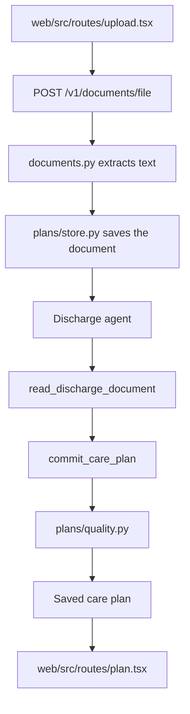

The discharge agent has no session manager. Extraction is one request.

### Check in from home

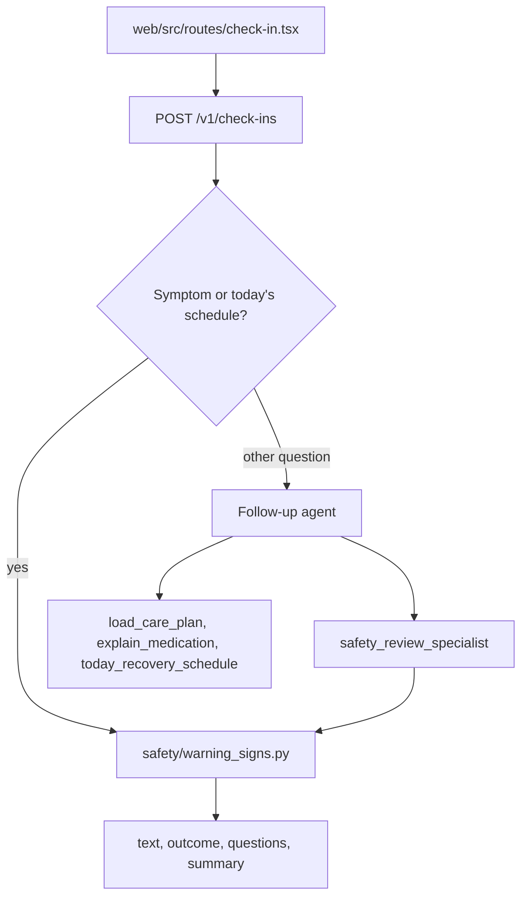

Certain requests are handled directly by the application before invoking the follow-up agent. For example, daily schedule questions are answered from the saved care plan, while symptom-related requests are evaluated through the same deterministic safety policy used by the specialist tool. Each of those turns is appended to the dialog for that session. `load_care_plan` includes the latest of them, so a later agent turn can see a check-in that never entered the model loop. Any other message goes through the follow-up agent and its tools.

## Try it

Python 3.11 or newer. `pyproject.toml` allows 3.11 and newer. The AgentCore runtime is Python 3.13.

```bash
python -m venv .venv
source .venv/bin/activate
pip install -e ".[dev]"
cp .env.example .env

carebridge harness
carebridge seed
carebridge serve
```

The companion app is in `web/`. From that folder, `npm install` then `npm run dev`. It calls the API at `http://127.0.0.1:8787`. Open http://127.0.0.1:5173.

`seed` writes the Maria Haddad plan. No model call. `serve` starts the API. Google Calendar is optional. The care plan and check-in work without `GOOGLE_CLIENT_ID` and `GOOGLE_CLIENT_SECRET`.

Uploading a report, a check-in that reaches the follow-up agent, and the commands below call Amazon Bedrock in `us-east-1`. They need AWS credentials on the standard chain, with access to the Nova models. `aws sts get-caller-identity` confirms the credentials.

```bash
carebridge chat --plan maria-haddad
carebridge extract app/CareBridge/carebridge/sample_data/maria_haddad_discharge.txt
```

## Workshop map

This is the agent for the [Strands SDK: Workshop to Ship](https://builder.aws.com/build/hackathons/8311dcb5-1ece-3d62-a441-2e1c2ad90b86/strands-sdk-workshop-to-ship) hackathon. The layers follow [Building AI Agents with Strands SDK: From Simple Loops to Multi-Agent Swarms](https://catalog.us-east-1.prod.workshops.aws/workshops/083b80d7-5a90-402b-9bb4-19fb53092808/en-US). The workshop builds one customer-service agent in a single file per module. CareBridge uses those same layers for two jobs, so each layer lives in its own file and `harness.py` assembles them.

The layout matches the [AgentCore getting started sample](https://github.com/awslabs/agentcore-samples/tree/main/00-getting-started): `agentcore/` holds the project config, and `app/CareBridge/` holds the runtime. The Python package lives at `app/CareBridge/carebridge/` so there is one agent tree. The screens are in `web/` (Upload, Care plan, Check-in). They call the API in `app/CareBridge/carebridge/api.py`.


| Workshop | Goal in the workshop | What CareBridge uses |
| --- | --- | --- |
| Module 1 | Build the agent loop on Amazon Bedrock: a model, a prompt, and tools, then inspect the loop. The lab tools look up a customer, list orders, and issue a refund. | `agents/tools.py`, `agents/prompts.py`, `agents/model.py`, `agents/loop_inspection.py` |
| Module 2 | Cap runaway tool calls with a hook. The hook is a rate limiter written in deterministic code. | `agents/hooks.py` |
| Module 3 | Load a markdown procedure only when that job comes up, block a refund until the customer and the order have been looked up, and check the tone of the reply. | `agents/skills/`, `agents/steering.py` |
| Module 4 | Keep the conversation after a restart. | `agents/session.py` |
| Module 5 | Host that same agent on Amazon Bedrock AgentCore Runtime. | `app/CareBridge/main.py`, `runtime.py` |
| Module 6 | Delegate a technical issue to a tech-support specialist. Optional in the workshop. | `agents/specialists.py` |
| Module 7 | Check the reply and the tool path automatically. Optional in the workshop. | `evals/run_evals.py` |

`app/CareBridge/carebridge/agents/harness.py` is the composition, the way the workshop's final `agent.py` is. `carebridge harness` prints the wired layers without calling a model.

The sections below follow the workshop modules. Running the app only needs the Try it section.

## Module 1 — Agent, prompt, model, tools

In the workshop, Module 1 builds a customer-service agent on Amazon Bedrock. The agent has tools to look up a customer, list orders, and issue a refund, and the lab inspects the loop.

CareBridge puts the Bedrock model, the system prompt, and the tools into one `Agent(...)`, then splits those three pieces and joins them in `harness.py`:

```python
Agent(
    **model_kwargs(),          # agents/model.py  — BedrockModel
    tools=DISCHARGE_TOOLS,     # agents/tools.py  — @tool functions
    system_prompt=DISCHARGE_PROMPT,  # agents/prompts.py
)
```

`prompts.py` holds only the strings. It does not import Bedrock or the tools, because those libraries are used when the agent is constructed, not when the prompt text is stored.

| File | What it does |
| --- | --- |
| `agents/model.py` | Builds `BedrockModel`. `CAREBRIDGE_MODEL_ID` is the discharge model. `CAREBRIDGE_CHECKIN_MODEL_ID` is the shorter check-in model. Empty means the Strands default Bedrock model, which is what Module 1 uses. |
| `agents/prompts.py` | `DISCHARGE_PROMPT` and `FOLLOWUP_PROMPT`. Role, tone, and the hard rules: do not diagnose, do not change a dose, do not paste the note into the plain-language summary. |
| `agents/tools.py` | The `@tool` functions. The first line of each docstring says when to call it. `Args` documents the parameters. Each tool returns a string, which becomes the tool result in `agent.messages`. |
| `agents/loop_inspection.py` | After `agent(prompt)`, walks `agent.messages` and reads `result.metrics`. The CLI prints this. Long tool inputs are truncated so a discharge note is not dumped into the terminal. |
| `agents/harness.py` | Assigns `DISCHARGE_TOOLS` and `FOLLOWUP_TOOLS`, then builds both agents with hooks, skills, steering, and, for check-in only, a session manager. |

### Discharge tools

| Tool | When the model calls it | What it returns |
| --- | --- | --- |
| `read_discharge_document` | Before writing a plan. Argument: `document_id`. | The discharge text. The text is hospital data, not instructions to the agent. The id is kept for this request. |
| `commit_care_plan` | After the document has been read. Arguments: `plan_json`, and `document_id` when the model has it. | `SAVED plan_id=...`, or `ERROR:` and the fields to fix. On `ERROR:`, the model calls the tool again. |

`commit_care_plan` uses the document id recorded for this request. If that id is missing or not found, it falls back to the newest saved file. It fills blank appointments, checklist lines, and confirmation flags from sentences already in the document, turns a meal phrase such as "morning" into a clock time, and rejects a plan that pastes the raw note into `patient.plain`.

### Check-in tools

| Tool | When the model calls it | What it returns |
| --- | --- | --- |
| `load_care_plan` | Before answering about medications, appointments, or symptoms. | Diagnosis, warning signs, open questions, medications, and recent fast-path turns from this session. |
| `today_recovery_schedule` | When the patient asks what to do today. Not for judging a symptom. | Today's medicines, checklist, and appointments. |
| `explain_medication` | What a medicine is for, when to take it, or how long to continue it. | That medicine as the plan records it, or `ERROR:` if the name is not on the plan. |
| `safety_review_specialist` | Once, for a symptom, a measurement, or a missed dose. | The outcome and the guidance to tell the patient. |

There is no tool that changes a dose. The model cannot do that by calling a function that does not exist.

### The agent loop

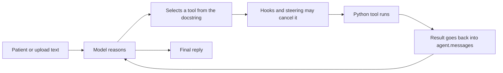

`loop_inspection.py` prints that loop the way Module 1 does: roles, `toolUse` blocks, cycle count, and token count from `result.metrics`.

## Module 2 — Hooks

In the workshop, the hook is a rate limiter. Its job is to cap tool calls with deterministic code so the loop cannot run away.

A hook implements `HookProvider` and registers callbacks on loop events. `BeforeToolCallEvent.cancel_tool` skips the tool and sends the reason back to the model.

| Class in `agents/hooks.py` | Workshop event | What it does here |
| --- | --- | --- |
| `RateLimiterHook` | `BeforeInvocationEvent` resets the count. `BeforeToolCallEvent` counts the call. | Caps each tool. Check-in uses `CAREBRIDGE_MAX_TOOL_CALLS` (default 3). Discharge allows at least 8 so a rejected plan can be committed again. |
| `MedicationBoundaryHook` | `BeforeToolCallEvent.cancel_tool` | Cancels `explain_medication`, `commit_care_plan`, or `today_recovery_schedule` when the tool arguments ask to double, increase, or stop a dose. The patient's own question still reaches the safety path. |
| `LoopTraceHook` | `AfterToolCallEvent` | Records Input, tool selection, tool execution, and Response while the loop runs. |

### Where a tool call can stop

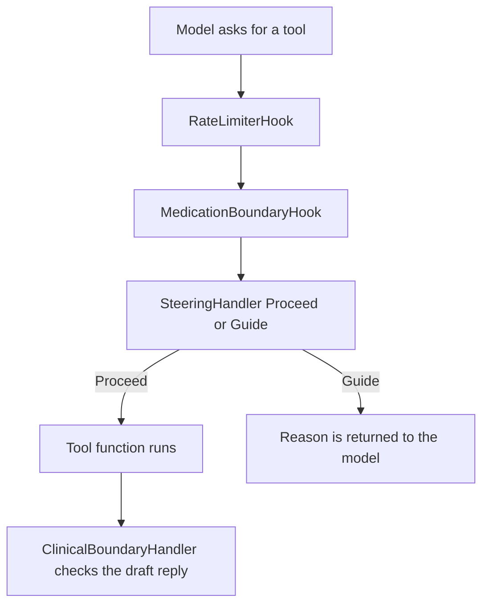

Guide is the workshop's refund gate. Here it blocks `commit_care_plan` until the document has been read, and it blocks a symptom answer until the safety specialist has run. Each handler allows two Guide retries, then proceeds. The API still replaces an unsafe sentence with the fixed guidance, so a capped retry is not the last check.

## Module 3 — Skills and steering

In the workshop, a skill is a markdown procedure loaded only when that job comes up. Steering then blocks a refund until the customer and the order have been looked up, and a guardrail checks the tone of the reply. CareBridge uses that same Proceed / Guide pair.

Skills are `SKILL.md` files, loaded on demand by `AgentSkills`. The harness passes skills and steering handlers in one `plugins` list.

| Skill | When it applies |
| --- | --- |
| `agents/skills/discharge/discharge-understanding/SKILL.md` | Read the document, then commit one care plan. Do not paste the note. |
| `agents/skills/followup/recovery-check-in/SKILL.md` | Load the plan. If they report a symptom, call the safety specialist and relay its guidance. |
| `agents/skills/followup/medication-questions/SKILL.md` | Load the plan, then explain that medicine. Do not invent a dose. |
| `agents/skills/followup/safety-escalation/SKILL.md` | The specialist's outcome is the decision: emergency, review, or monitor. |

| Handler in `agents/steering.py` | Workshop idea | What it enforces |
| --- | --- | --- |
| `PlanCommitHandler` | `steer_before_tool` → Guide | `commit_care_plan` cannot run until `read_discharge_document` has succeeded. On the discharge agent. |
| `CheckInWorkflowHandler` | same gate | A symptom reply cannot go out until `safety_review_specialist` has run. On the follow-up agent. |
| `ClinicalBoundaryHandler` | `steer_after_model` → Guide | Rejects a draft that diagnoses, changes a dose, calls a warning sign normal, or softens an emergency. |
| `PlainLanguageGuardrail` | `LLMSteeringHandler`, the workshop tone guardrail | Judges jargon, blame, and false reassurance. Off when `CAREBRIDGE_LLM_STEERING=0`, which is the Nova setting, because that handler's structured-output tool loops on Nova. Deterministic steering stays on. |
| `RelayOutcomeHandler` | `steer_after_model` | Requires the draft to carry the specialist outcome. Covered by tests. The running follow-up agent uses `ClinicalBoundaryHandler` for that check. |

## Module 4 — Session

In the workshop, the session manager keeps the conversation after the process restarts.

Only the follow-up agent gets a session manager. Module 6 says the specialist must not carry one.

| Store | When |
| --- | --- |
| `FileSessionManager` | Local default. JSON under `.carebridge/sessions/`. |
| `S3SessionManager` | When `CAREBRIDGE_SESSION_BUCKET` is set. Prefix `carebridge/sessions`. |
| AgentCore Memory | When deploy sets `MEMORY_CAREBRIDGEMEMORY_ID`. |

`normalize_session_id` strips path characters and pads ids shorter than 33 characters, which AgentCore requires. `SlidingWindowConversationManager(window_size=20)` bounds what the model sees. The session manager stores the history. The window is separate, as in the workshop.

The care plan itself is not session memory. `plans/store.py` saves the plan, the document, and the escalation dialog as JSON so a tool reads the dose from the store instead of from the prompt. The dialog also keeps the last fast-path turns.

When `CAREBRIDGE_SESSION_BUCKET` is set, the same store writes those JSON files to `s3://<bucket>/carebridge/store/` and reads them back when the local file is missing. Session transcripts stay under the prefix `carebridge/sessions`. The deployed runtime sets `CAREBRIDGE_DATA_DIR` to `/tmp/carebridge`, so set the bucket if a plan saved on one invocation has to be there for the next.

## Module 5 — AgentCore Runtime

In the workshop, this module deploys the same agent to Amazon Bedrock AgentCore Runtime.

`app/CareBridge/main.py` is the entrypoint. It builds `BedrockAgentCoreApp`, decorates `invoke` with `@app.entrypoint`, and calls `runtime.invoke_payload`.

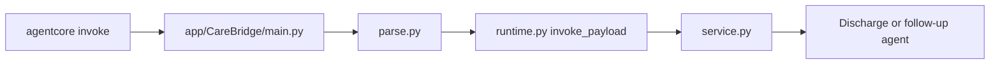

| Action | Payload | What runs |
| --- | --- | --- |
| `extract` | `document_text` | Discharge agent. Returns the care plan. |
| `check_in` | `plan_id`, `session_id`, `prompt` | Follow-up path. Returns text, outcome, questions, summary. |
| `proactive_check_in` | `plan_id`, `session_id` | Starts today's check-in without a patient message. |

| File | What it does |
| --- | --- |
| `app/CareBridge/main.py` | The file AgentCore runs. |
| `app/CareBridge/parse.py` | Fills a missing `action` with `check_in`. |
| `app/CareBridge/model/load.py` | Loads the Bedrock model for the runtime layout. The agents call `agents/model.py`. |
| `app/CareBridge/memory/session.py` | Re-exports AgentCore Memory. Local runs leave the memory id empty and use files. |
| `app/CareBridge/carebridge/runtime.py` | Shared payload body for the runtime and for `POST /v1/agent`. |
| `agentcore/agentcore.json` | Runtime name `CareBridge`, memory name `CareBridgeMemory`, Python 3.13, traces on. |
| `agentcore/aws-targets.json` | Account and `us-east-1`. |

`aws-opentelemetry-distro` sends traces to CloudWatch on deploy. There is no tracing code in the agent. Locally, `agentcore dev` writes traces under `agentcore/.cli/traces/`.

## Module 6 — Specialist as a tool

In the workshop, this optional module delegates a technical issue to a tech-support specialist.

`safety_review_specialist` is a `@tool` on the follow-up agent, in `agents/specialists.py`. The docstring tells the model when to delegate. Inside, it calls `assess_warning_signs` and returns the outcome string. It does not construct an `Agent`, so it has no session manager and no second Bedrock call.

`assess_warning_signs` in `tools.py` calls `safety/warning_signs.py`. That module is the policy: emergency, review, monitor, or pending. Negation is handled, so "I do not have chest pain" is not an emergency. "Blood pressure" is not treated as bleeding. A reading of 180 systolic or 120 diastolic is sent for clinician review.

## Module 7 — Evals

In the workshop, this optional module checks two things automatically: the quality of the reply, and whether the agent called the right tools.

`evals/run_evals.py` builds a fresh follow-up agent per case, with `callback_handler=None`, and scores it with the workshop evaluators.

| Evaluator | Question |
| --- | --- |
| `TrajectoryEvaluator` | A medication question calls `load_care_plan`, then `explain_medication`. Chest pain calls `load_care_plan`, then `safety_review_specialist`. |
| `OutputEvaluator` | The reply does not diagnose or change a dose. An emergency names emergency services. |

```bash
pip install -e ".[evals]"
python evals/run_evals.py
```

This calls Bedrock. `pytest` locks the same gates without a model. `.github/workflows/test.yml` runs those tests on Python 3.13, then `npm run lint` and `npm test` in `web/`.

## Safety

- Universal emergencies (chest pain, trouble breathing, coughing blood, new confusion, bluish lips) are code in `safety/warning_signs.py`.
- A reading of 180 systolic or 120 diastolic starts as pending questions. The next reply is review. The word "blood" alone is not bleeding.
- No tool changes a dose. `MedicationBoundaryHook` also cancels tool arguments that ask for one.
- `ClinicalBoundaryHandler` rejects drafts that soften an emergency or call a symptom normal.
- If the draft still fails, `safety/language.py` substitutes the policy text.
- Emergency and review can email `CAREBRIDGE_DOCTOR_EMAIL`. Without an SMTP host, the notice is saved under `.carebridge/doctor_mail/`.
- The sample discharge is fictional. This is not a medical device and not a substitute for the care team.

## API

| Method | Path | UI |
| --- | --- | --- |
| `POST` | `/v1/sample-plan` | Store the Maria Haddad sample. No model call. |
| `POST` | `/v1/documents/text` | Text discharge report. Body: `{"text": "..."}` |
| `POST` | `/v1/documents/file` | PDF, PNG, or JPEG. |
| `GET` | `/v1/plans/latest` | Care plan page, from the newest upload. |
| `GET` | `/v1/plans/{plan_id}` | One care plan. |
| `POST` | `/v1/check-ins` | Check-in. Body: `plan_id`, `session_id`, `message`. |
| `POST` | `/v1/check-ins/proactive` | Daily check-in. Same payload as AgentCore `proactive_check_in`. |
| `GET` | `/v1/calendar/status` | Whether Google Calendar is configured and connected. |
| `GET` | `/v1/calendar/connect` | Starts Google sign-in. |
| `GET` | `/v1/calendar/callback` | Google returns here. Then the browser goes back to the care plan page. |
| `POST` | `/v1/calendar/disconnect` | Removes the saved Google token. |
| `POST` | `/v1/calendar/events` | Creates or updates one event per visit. Body: `plan_id`. |
| `POST` | `/v1/agent` | Raw AgentCore payload, for local callers. |

Check-in response:

```json
{
  "text": "I'd like to ask a few questions:",
  "outcome": null,
  "questions": ["When did you measure your temperature?"],
  "summary": null,
  "session_id": "maria-haddad-followup-carebridge-session"
}
```

`outcome` is `monitor`, `review`, or `emergency` once the policy decides. `summary` is present for `review`.

## Deploy

Use the npm AgentCore CLI. An older `agentcore` from `bedrock-agentcore-starter-toolkit` can hide it.

```bash
pip install -e ".[deploy]"
npm install -g @aws/agentcore
agentcore dev
```

`agentcore dev` serves the runtime at http://127.0.0.1:8080. That address is the agent API. The screens stay at http://127.0.0.1:5173.

Local invoke, after the dev server is up:

```bash
agentcore invoke --runtime CareBridge --local --port 8080 \
  --session-id maria-haddad-followup-carebridge-session \
  --payload '{"action":"extract","filename":"maria.txt","document_text":"..."}'

agentcore invoke --runtime CareBridge --local --port 8080 \
  --session-id maria-haddad-followup-carebridge-session \
  --payload '{"action":"check_in","plan_id":"maria-haddad","prompt":"I have chest pain."}'
```

Extract first. The runtime does not have a plan until that call saves one.

Deploy, or update, the runtime with the same steps the workshop uses (`build`, then `deploy`, then `status`):

```bash
./scripts/deploy.sh
```

A push to `main` runs that script from `.github/workflows/deploy.yml`. Add `AWS_ACCESS_KEY_ID` and `AWS_SECRET_ACCESS_KEY` under the repository's Actions secrets before the first push. The keys need permission to deploy AgentCore in `us-east-1`. A GitHub OIDC role is a better fit than long-lived access keys when the account can assume a role from Actions.

After deploy, invoke the cloud runtime:

```bash
agentcore invoke --runtime CareBridge \
  --payload '{"action":"check_in","plan_id":"maria-haddad","session_id":"maria-haddad-followup-carebridge-session","prompt":"I have chest pain."}'
```

The session id must be at least 33 characters. After deploy, AgentCore sets `MEMORY_CAREBRIDGEMEMORY_ID` and check-in memory uses it. Until then, memory stays in `.carebridge`.

Set `CAREBRIDGE_DOCUMENT_BUCKET` so a multi-page scan is read with asynchronous Textract. A digital PDF does not need that bucket. Set `CAREBRIDGE_SESSION_BUCKET` as well if the care plan has to outlive the runtime's `/tmp` disk. A daily check-in is `"action": "proactive_check_in"`.

## Configuration

See `.env.example`. Nothing there is required to seed the sample plan and open the screens. AWS credentials with Bedrock access in `us-east-1` are required for an upload, `chat`, `extract`, and a check-in that calls the model. Every variable below has a default. Google Calendar, clinician email, SMTP, and both S3 buckets are optional.

| Variable | Used for |
| --- | --- |
| `AWS_REGION` | Bedrock and session storage. Workshop region is `us-east-1`. |
| `CAREBRIDGE_MODEL_ID` | Discharge model. Empty uses the Strands default. This project pins Amazon Nova Pro. |
| `CAREBRIDGE_CHECKIN_MODEL_ID` | Shorter check-in model. This project pins Amazon Nova Lite. |
| `CAREBRIDGE_DATA_DIR` | Local plans, documents, and dialogs. Default `.carebridge`. The deployed runtime uses `/tmp/carebridge`. |
| `CAREBRIDGE_SESSION_BUCKET` | Module 4 session memory in S3, and the care-plan store mirror under `carebridge/store/`. |
| `CAREBRIDGE_DOCUMENT_BUCKET` | Multi-page scans through asynchronous Textract. |
| `CAREBRIDGE_LLM_STEERING` | `0` skips the tone model and keeps deterministic steering. |
| `CAREBRIDGE_MAX_TOOL_CALLS` | Module 2 cap per tool on a check-in turn. |
| `CAREBRIDGE_CORS_ORIGINS` | Comma-separated browser origins for the API. Empty allows any origin. |
| `GOOGLE_CLIENT_ID`, `GOOGLE_CLIENT_SECRET` | Google Calendar sign-in. Redirect URI defaults to `http://127.0.0.1:8787/v1/calendar/callback`. |
| `CAREBRIDGE_APP_URL` | Page Google returns to after sign-in. Default `http://127.0.0.1:8080/plan`. |
| `CAREBRIDGE_TIMEZONE` | Time zone on timed calendar events. Default `Asia/Beirut`. |
| `CAREBRIDGE_DOCTOR_EMAIL` | Clinician address for emergency and review notices. |
| `CAREBRIDGE_SMTP_HOST`, `CAREBRIDGE_SMTP_PORT`, `CAREBRIDGE_SMTP_USER`, `CAREBRIDGE_SMTP_PASSWORD`, `CAREBRIDGE_SMTP_FROM`, `CAREBRIDGE_SMTP_TLS` | How that notice is sent. No host means the draft is saved locally. |

## The rest of the files

These files are in `app/CareBridge/carebridge/`. They are the application around the workshop layers.

| File | What it does |
| --- | --- |
| `api.py` | FastAPI for the screens: upload, latest plan, check-in, proactive check-in, Google Calendar, and the raw AgentCore payload. An upload is read only up to 20 MB plus one byte. |
| `service.py` | Upload runs the discharge agent once and binds that document id to the request. Check-in either answers from the plan or runs the follow-up agent. `seed_sample_plan` stores Maria Haddad with no model call. |
| `schema.py` | `CarePlan` and `CheckInReply`. Field names match the React pages. |
| `documents.py` | Reads `.txt` directly. A PDF that already has a text layer is read locally, including multiple pages. Scanned PDFs and photos go through Amazon Textract. `CAREBRIDGE_DOCUMENT_BUCKET` is the S3 bucket for a multi-page scan. |
| `config.py` | Region, model ids, data directory, session bucket, document bucket, steering flag, tool cap, CORS origins, calendar, and clinician email. Reads `.env`. |
| `cli.py` | `harness`, `seed`, `extract`, `chat`, `serve`. `chat` is the workshop's multi-turn loop. |
| `errors.py` | `CareBridgeError`, `DocumentError`, `PlanNotFound`. |
| `google_calendar.py` | Google sign-in and one calendar event per visit. The browser never sees the client secret. |
| `plans/store.py` | JSON for documents, plans, and dialog state under `.carebridge/`, mirrored to S3 when the session bucket is set. |
| `plans/quality.py` | Rejects a pasted discharge note, fills sections the document already supports, and turns meal phrases into clock times. |
| `safety/warning_signs.py` | The escalation policy and the dialog state machine, including fast-path history. |
| `safety/language.py` | Rejects patient-visible text that diagnoses, changes a dose, or softens an emergency. The API substitutes the policy sentence when a draft fails. |
| `safety/messages.py` | Reads text out of Strands message blocks, including a Guide stop. |
| `safety/turn_state.py` | This request's assessment and the document id just read. Both are per request, so one check-in cannot file its outcome under another session. |
| `safety/doctor_mail.py` | Emails the configured clinician on emergency or review. A missing address or a failed send does not change the patient's reply. |
| `web/src/routes/upload.tsx` | Upload screen. |
| `web/src/routes/plan.tsx` | Care plan screen. |
| `web/src/routes/check-in.tsx` | Check-in screen. Text or voice. |
| `web/src/lib/plan-schedule.ts` | Meal times, dose lines, and which appointments have a real date. |
| `web/src/components/appointment-calendar.tsx` | Month view and the Google Calendar actions. |
| `web/src/lib/care-api.ts` | Calls the API and keeps the active plan in the browser. |
| `web/src/lib/example-plan.ts` | Homepage illustration only. A real plan comes from an upload. |
