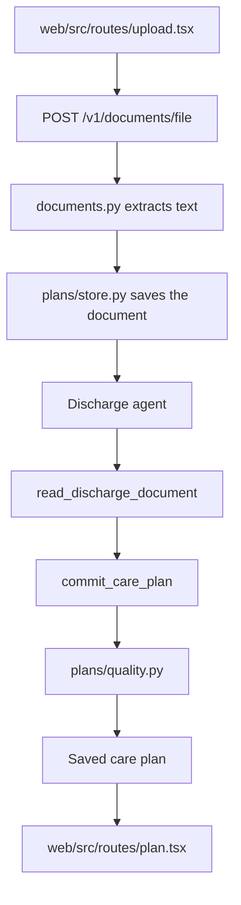
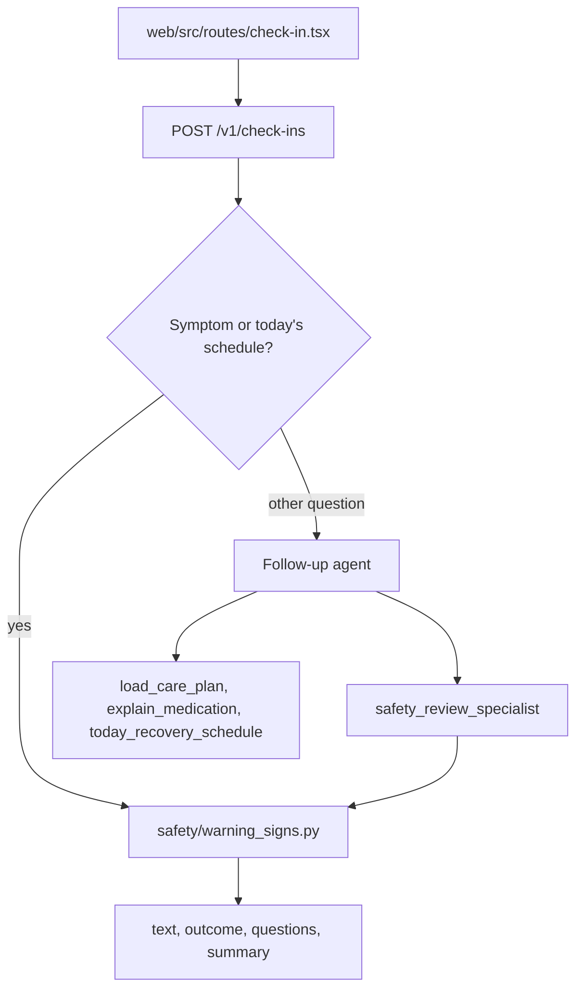
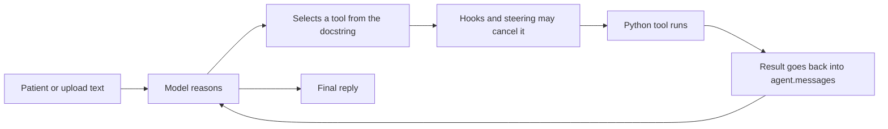
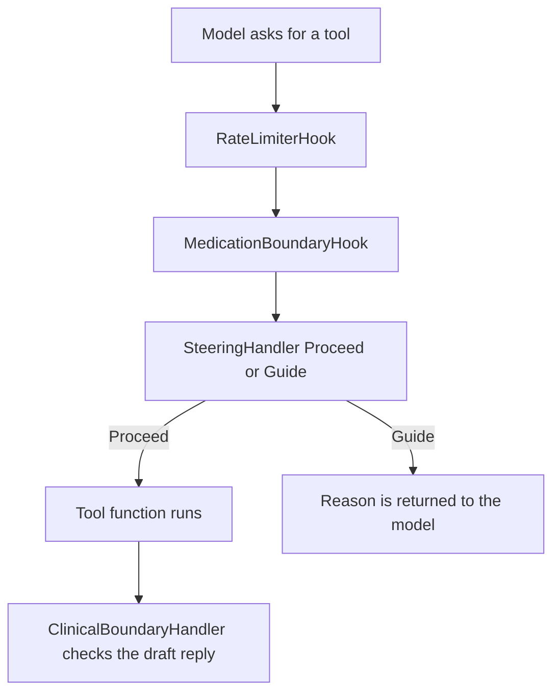
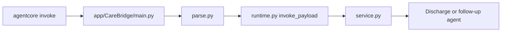

# CareBridge

CareBridge is a post-discharge care companion. A patient uploads a hospital discharge report. One agent turns it into a care plan: medications, appointments, a daily checklist, items to confirm with a clinician, and warning signs. A second agent stays with them at home. A check-in ends as **monitor**, **review**, or **emergency**.

It does not diagnose, and it does not change a dose. Escalation is Python. The model explains that decision in plain language.

This is the agent for the [Strands SDK: Workshop to Ship](https://builder.aws.com/build/hackathons/8311dcb5-1ece-3d62-a441-2e1c2ad90b86/strands-sdk-workshop-to-ship) hackathon. The layers follow [Building AI Agents with Strands SDK: From Simple Loops to Multi-Agent Swarms](https://catalog.us-east-1.prod.workshops.aws/workshops/083b80d7-5a90-402b-9bb4-19fb53092808/en-US). The workshop builds one customer-service agent in a single file per module. CareBridge uses those same layers for two jobs, so each layer lives in its own file and `harness.py` assembles them.

The layout matches the [AgentCore getting started sample](https://github.com/awslabs/agentcore-samples/tree/main/00-getting-started): `agentcore/` holds the project config, and `app/CareBridge/` holds the runtime. The Python package lives at `app/CareBridge/carebridge/` so there is one agent tree. The screens are in `web/` (Upload, Care plan, Check-in). They call the API in `app/CareBridge/carebridge/api.py`.

## Workshop map

| Workshop | What it taught | What CareBridge uses |
| --- | --- | --- |
| Module 1 | `@tool`, `Agent`, the loop, `agent.messages`, `result.metrics` | `agents/tools.py`, `agents/prompts.py`, `agents/model.py`, `agents/loop_inspection.py` |
| Module 2 | `HookProvider`, `BeforeToolCallEvent.cancel_tool`, rate limiter | `agents/hooks.py` |
| Module 3 | `SKILL.md`, `SteeringHandler` Proceed / Guide, `LLMSteeringHandler` | `agents/skills/`, `agents/steering.py` |
| Module 4 | `FileSessionManager`, `S3SessionManager`, sliding window of 20 | `agents/session.py` |
| Module 5 | `BedrockAgentCoreApp`, `@app.entrypoint` | `app/CareBridge/main.py`, `runtime.py` |
| Module 6 | A specialist exposed as one `@tool`, no inner session, no nested model loop | `agents/specialists.py` |
| Module 7 | `OutputEvaluator`, `TrajectoryEvaluator` | `evals/run_evals.py` |

`app/CareBridge/carebridge/agents/harness.py` is the composition, the way the workshop's final `agent.py` is. `carebridge harness` prints the wired layers without calling a model.

## Flows

### Upload a discharge report



The discharge agent has no session manager. Extraction is one request.

### Check in from home



A symptom such as chest pain, and a question like "what should I do today?", are answered from the saved plan in `service.py` before an agent is built. The outcome still comes from `warning_signs.py`, the same policy the specialist tool runs. Any other message goes through the follow-up agent and its tools.

### The agent loop, Module 1



`loop_inspection.py` prints that loop the way Module 1 does: roles, `toolUse` blocks, cycle count, and token count from `result.metrics`.

### Where a tool call can stop



Guide is the workshop's refund gate. Here it blocks `commit_care_plan` until the document has been read, and it blocks a symptom answer until the safety specialist has run. Each handler allows two Guide retries, then proceeds. The API still replaces an unsafe sentence with the fixed guidance, so a capped retry is not the last check.

## Module 1 — Agent, prompt, model, tools

Module 1 puts the Bedrock model, the system prompt, and the tools into one `Agent(...)`. CareBridge splits those three pieces and joins them in `harness.py`:

```python
Agent(
    **model_kwargs(),          # agents/model.py  — BedrockModel
    tools=DISCHARGE_TOOLS,     # agents/tools.py  — @tool functions
    system_prompt=DISCHARGE_PROMPT,  # agents/prompts.py
)
```

`prompts.py` holds only the strings. It does not import Bedrock or the tools, because those libraries are used when the agent is constructed, not when the prompt text is stored.

| File | What it does |
| --- | --- |
| `agents/model.py` | Builds `BedrockModel`. `CAREBRIDGE_MODEL_ID` is the discharge model. `CAREBRIDGE_CHECKIN_MODEL_ID` is the shorter check-in model. Empty means the Strands default Bedrock model, which is what Module 1 uses. |
| `agents/prompts.py` | `DISCHARGE_PROMPT` and `FOLLOWUP_PROMPT`. Role, tone, and the hard rules: do not diagnose, do not change a dose, do not paste the note into the plain-language summary. |
| `agents/tools.py` | The `@tool` functions. The first line of each docstring says when to call it. `Args` documents the parameters. Each tool returns a string, which becomes the tool result in `agent.messages`. |
| `agents/loop_inspection.py` | After `agent(prompt)`, walks `agent.messages` and reads `result.metrics`. The CLI prints this. Long tool inputs are truncated so a discharge note is not dumped into the terminal. |
| `agents/harness.py` | Assigns `DISCHARGE_TOOLS` and `FOLLOWUP_TOOLS`, then builds both agents with hooks, skills, steering, and, for check-in only, a session manager. |

### Discharge tools

| Tool | When the model calls it | What it returns |
| --- | --- | --- |
| `read_discharge_document` | Before writing a plan. Argument: `document_id`. | The discharge text. The text is hospital data, not instructions to the agent. |
| `commit_care_plan` | After the document has been read. Argument: `plan_json`. | `SAVED plan_id=...`, or `ERROR:` and the fields to fix. On `ERROR:`, the model calls the tool again. |

`commit_care_plan` fills blank appointments, checklist lines, and confirmation flags from sentences already in the document, then rejects a plan that pastes the raw note into `patient.plain`.

### Check-in tools

| Tool | When the model calls it | What it returns |
| --- | --- | --- |
| `load_care_plan` | Before answering about medications, appointments, or symptoms. | Diagnosis, warning signs, open questions, and medications. |
| `today_recovery_schedule` | When the patient asks what to do today. Not for judging a symptom. | Today's medicines, checklist, and appointments. |
| `explain_medication` | What a medicine is for, when to take it, or how long to continue it. | That medicine as the plan records it, or `ERROR:` if the name is not on the plan. |
| `safety_review_specialist` | Once, for a symptom, a measurement, or a missed dose. | The outcome and the guidance to tell the patient. |

There is no tool that changes a dose. The model cannot do that by calling a function that does not exist.

## Module 2 — Hooks

A hook implements `HookProvider` and registers callbacks on loop events. `BeforeToolCallEvent.cancel_tool` skips the tool and sends the reason back to the model.

| Class in `agents/hooks.py` | Workshop event | What it does here |
| --- | --- | --- |
| `RateLimiterHook` | `BeforeInvocationEvent` resets the count. `BeforeToolCallEvent` counts the call. | Caps each tool. Check-in uses `CAREBRIDGE_MAX_TOOL_CALLS` (default 3). Discharge allows at least 8 so a rejected plan can be committed again. |
| `MedicationBoundaryHook` | `BeforeToolCallEvent.cancel_tool` | Cancels `explain_medication`, `commit_care_plan`, or `today_recovery_schedule` when the tool arguments ask to double, increase, or stop a dose. The patient's own question still reaches the safety path. |
| `LoopTraceHook` | `AfterToolCallEvent` | Records Input, tool selection, tool execution, and Response while the loop runs. |

## Module 3 — Skills and steering

Skills suggest a procedure. Steering blocks the shortcut. The workshop blocks a refund until the customer and the order have been looked up. CareBridge uses that same Proceed / Guide pair.

Skills are `SKILL.md` files, loaded on demand by `AgentSkills`. The harness passes skills and steering handlers in one `plugins` list.

| Skill | When it applies |
| --- | --- |
| `agents/skills/discharge/discharge-understanding/SKILL.md` | Read the document, then commit one care plan. Do not paste the note. |
| `agents/skills/followup/recovery-check-in/SKILL.md` | Load the plan. If they report a symptom, call the safety specialist and relay its guidance. |
| `agents/skills/followup/medication-questions/SKILL.md` | Load the plan, then explain that medicine. Do not invent a dose. |
| `agents/skills/followup/safety-escalation/SKILL.md` | The specialist's outcome is the decision: emergency, review, or monitor. |

| Handler in `agents/steering.py` | Workshop idea | What it enforces |
| --- | --- | --- |
| `PlanCommitHandler` | `steer_before_tool` → Guide | `commit_care_plan` cannot run until `read_discharge_document` has succeeded. On the discharge agent. |
| `CheckInWorkflowHandler` | same gate | A symptom reply cannot go out until `safety_review_specialist` has run. On the follow-up agent. |
| `ClinicalBoundaryHandler` | `steer_after_model` → Guide | Rejects a draft that diagnoses, changes a dose, calls a warning sign normal, or softens an emergency. |
| `PlainLanguageGuardrail` | `LLMSteeringHandler`, the workshop tone guardrail | Judges jargon, blame, and false reassurance. Off when `CAREBRIDGE_LLM_STEERING=0`, which is the Nova setting, because that handler's structured-output tool loops on Nova. Deterministic steering stays on. |
| `RelayOutcomeHandler` | `steer_after_model` | Requires the draft to carry the specialist outcome. Covered by tests. The running follow-up agent uses `ClinicalBoundaryHandler` for that check. |

## Module 4 — Session

Only the follow-up agent gets a session manager. Module 6 says the specialist must not carry one.

| Store | When |
| --- | --- |
| `FileSessionManager` | Local default. JSON under `.carebridge/sessions/`. |
| `S3SessionManager` | When `CAREBRIDGE_SESSION_BUCKET` is set. Prefix `carebridge/sessions`. |
| AgentCore Memory | When deploy sets `MEMORY_CAREBRIDGEMEMORY_ID`. |

`normalize_session_id` strips path characters and pads ids shorter than 33 characters, which AgentCore requires. `SlidingWindowConversationManager(window_size=20)` bounds what the model sees. The session manager stores the history. The window is separate, as in the workshop.

The care plan itself is not session memory. `plans/store.py` saves the plan, the document, and the escalation dialog as JSON so a tool reads the dose from disk instead of from the prompt.

## Module 5 — AgentCore Runtime

`app/CareBridge/main.py` is the entrypoint. It builds `BedrockAgentCoreApp`, decorates `invoke` with `@app.entrypoint`, and calls `runtime.invoke_payload`.



| Action | Payload | What runs |
| --- | --- | --- |
| `extract` | `document_text` | Discharge agent. Returns the care plan. |
| `check_in` | `plan_id`, `session_id`, `prompt` | Follow-up path. Returns text, outcome, questions, summary. |
| `proactive_check_in` | `plan_id`, `session_id` | Starts today's check-in without a patient message. |

| File | What it does |
| --- | --- |
| `app/CareBridge/main.py` | The file AgentCore runs. |
| `app/CareBridge/parse.py` | Fills a missing `action` with `check_in`. |
| `app/CareBridge/model/load.py` | Loads the Bedrock model for the runtime layout. The agents call `agents/model.py`. |
| `app/CareBridge/memory/session.py` | Re-exports AgentCore Memory. Local runs leave the memory id empty and use files. |
| `app/CareBridge/carebridge/runtime.py` | Shared payload body for the runtime and for `POST /v1/agent`. |
| `agentcore/agentcore.json` | Runtime name `CareBridge`, memory name `CareBridgeMemory`, Python 3.13, traces on. |
| `agentcore/aws-targets.json` | Account and `us-east-1`. |

`aws-opentelemetry-distro` sends traces to CloudWatch on deploy. There is no tracing code in the agent. Locally, `agentcore dev` writes traces under `agentcore/.cli/traces/`.

## Module 6 — Specialist as a tool

`safety_review_specialist` is a `@tool` on the follow-up agent, in `agents/specialists.py`. The docstring tells the model when to delegate. Inside, it calls `assess_warning_signs` and returns the outcome string. It does not construct an `Agent`, so it has no session manager and no second Bedrock call.

`assess_warning_signs` in `tools.py` calls `safety/warning_signs.py`. That module is the policy: emergency, review, monitor, or pending. Negation is handled, so "I do not have chest pain" is not an emergency. "Blood pressure" is not treated as bleeding. A reading of 180 systolic or 120 diastolic is sent for clinician review.

## Module 7 — Evals

`evals/run_evals.py` builds a fresh follow-up agent per case, with `callback_handler=None`, and scores it with the workshop evaluators.

| Evaluator | Question |
| --- | --- |
| `TrajectoryEvaluator` | A medication question calls `load_care_plan`, then `explain_medication`. Chest pain calls `load_care_plan`, then `safety_review_specialist`. |
| `OutputEvaluator` | The reply does not diagnose or change a dose. An emergency names emergency services. |

```bash
pip install -e ".[evals]"
python evals/run_evals.py
```

This calls Bedrock. `pytest` locks the same gates without a model.

## The rest of the files

These files are in `app/CareBridge/carebridge/`. They are the application around the workshop layers.

| File | What it does |
| --- | --- |
| `api.py` | FastAPI for the screens: upload, latest plan, check-in, proactive check-in, and the raw AgentCore payload. |
| `service.py` | Upload runs the discharge agent once. Check-in either answers from the plan or runs the follow-up agent. `seed_sample_plan` stores Maria Haddad with no model call. |
| `schema.py` | `CarePlan` and `CheckInReply`. Field names match the React pages. |
| `documents.py` | Reads `.txt` directly. PDF and photos go through Amazon Textract. A bucket in `CAREBRIDGE_DOCUMENT_BUCKET` is used for multi-page PDFs. |
| `config.py` | Region, model ids, data directory, session bucket, steering flag, tool cap. Reads `.env`. |
| `cli.py` | `harness`, `seed`, `extract`, `chat`, `serve`. `chat` is the workshop's multi-turn loop. |
| `errors.py` | `CareBridgeError`, `DocumentError`, `PlanNotFound`. |
| `plans/store.py` | JSON files for documents, plans, and dialog state under `.carebridge/`. |
| `plans/quality.py` | Rejects a pasted discharge note and fills sections the document already supports. |
| `safety/warning_signs.py` | The escalation policy and the dialog state machine. |
| `safety/language.py` | Rejects patient-visible text that diagnoses, changes a dose, or softens an emergency. The API substitutes the policy sentence when a draft fails. |
| `safety/messages.py` | Reads text out of Strands message blocks, including a Guide stop. |
| `safety/turn_state.py` | Holds this turn's assessment so the reply check can see the tool outcome. |
| `web/src/routes/upload.tsx` | Upload screen. |
| `web/src/routes/plan.tsx` | Care plan screen. |
| `web/src/routes/check-in.tsx` | Check-in screen. |
| `web/src/lib/care-api.ts` | Calls the API and keeps the active plan in the browser. |
| `web/src/lib/example-plan.ts` | Homepage illustration only. A real plan comes from an upload. |

## Run locally

Python 3.11 or newer. The workshop uses 3.13. Bedrock is called in `us-east-1`.

```bash
python -m venv .venv
source .venv/bin/activate
pip install -e ".[dev]"
cp .env.example .env

carebridge harness
carebridge seed
carebridge serve
```

The companion app is in `web/`. From that folder, `npm install` then `npm run dev`. It calls the API at `http://127.0.0.1:8787`. Open http://127.0.0.1:5173.

`seed` writes the Maria Haddad plan. No model call.

```bash
carebridge chat --plan maria-haddad
carebridge extract app/CareBridge/carebridge/sample_data/maria_haddad_discharge.txt
```

`chat` and `extract` call Amazon Bedrock. Credentials are the standard AWS chain (`aws sts get-caller-identity`).

### API

| Method | Path | UI |
| --- | --- | --- |
| `POST` | `/v1/sample-plan` | Store the Maria Haddad sample. No model call. |
| `POST` | `/v1/documents/text` | Text discharge report. Body: `{"text": "..."}` |
| `POST` | `/v1/documents/file` | PDF, PNG, or JPEG. |
| `GET` | `/v1/plans/latest` | Care plan page, from the newest upload. |
| `GET` | `/v1/plans/{plan_id}` | One care plan. |
| `POST` | `/v1/check-ins` | Check-in. Body: `plan_id`, `session_id`, `message`. |
| `POST` | `/v1/check-ins/proactive` | Daily check-in. Same payload as AgentCore `proactive_check_in`. |
| `POST` | `/v1/agent` | Raw AgentCore payload, for local callers. |

Check-in response:

```json
{
  "text": "I'd like to ask a few questions:",
  "outcome": null,
  "questions": ["When did you measure your temperature?"],
  "summary": null,
  "session_id": "maria-haddad-followup-carebridge-session"
}
```

`outcome` is `monitor`, `review`, or `emergency` once the policy decides. `summary` is present for `review`.

## Safety

- Universal emergencies (chest pain, trouble breathing, coughing blood, new confusion, bluish lips) are code in `safety/warning_signs.py`.
- A high blood-pressure reading is clinician review. The word "blood" alone is not bleeding.
- No tool changes a dose. `MedicationBoundaryHook` also cancels tool arguments that ask for one.
- `ClinicalBoundaryHandler` rejects drafts that soften an emergency or call a symptom normal.
- If the draft still fails, `safety/language.py` substitutes the policy text.
- The sample discharge is fictional. This is not a medical device and not a substitute for the care team.

## Deploy

Use the npm AgentCore CLI. An older `agentcore` from `bedrock-agentcore-starter-toolkit` can hide it.

```bash
pip install -e ".[deploy]"
npm install -g @aws/agentcore
agentcore dev
```

`agentcore dev` serves the runtime at http://127.0.0.1:8080. That address is the agent API. The screens stay at http://127.0.0.1:5173.

Local invoke, after the dev server is up:

```bash
agentcore invoke --runtime CareBridge --local --port 8080 \
  --session-id maria-haddad-followup-carebridge-session \
  --payload '{"action":"extract","filename":"maria.txt","document_text":"..."}'

agentcore invoke --runtime CareBridge --local --port 8080 \
  --session-id maria-haddad-followup-carebridge-session \
  --payload '{"action":"check_in","plan_id":"maria-haddad","prompt":"I have chest pain."}'
```

Extract first. The runtime does not have a plan until that call saves one.

Deploy, or update, the runtime with the same steps the workshop uses (`build`, then `deploy`, then `status`):

```bash
./scripts/deploy.sh
```

A push to `main` runs that script from `.github/workflows/deploy.yml`. Add `AWS_ACCESS_KEY_ID` and `AWS_SECRET_ACCESS_KEY` under the repository's Actions secrets before the first push. The keys need permission to deploy AgentCore in `us-east-1`.

After deploy, invoke the cloud runtime:

```bash
agentcore invoke --runtime CareBridge \
  --payload '{"action":"check_in","plan_id":"maria-haddad","session_id":"maria-haddad-followup-carebridge-session","prompt":"I have chest pain."}'
```

The session id must be at least 33 characters. After deploy, AgentCore sets `MEMORY_CAREBRIDGEMEMORY_ID` and check-in memory uses it. Until then, memory stays in `.carebridge`.

Set `CAREBRIDGE_DOCUMENT_BUCKET` so multi-page PDFs are read with asynchronous Textract. A daily check-in is `"action": "proactive_check_in"`.

## Configuration

See `.env.example`.

| Variable | Used for |
| --- | --- |
| `AWS_REGION` | Bedrock and session storage. Workshop region is `us-east-1`. |
| `CAREBRIDGE_MODEL_ID` | Discharge model. Empty uses the Strands default. This project pins Amazon Nova Pro. |
| `CAREBRIDGE_CHECKIN_MODEL_ID` | Shorter check-in model. This project pins Amazon Nova Lite. |
| `CAREBRIDGE_DATA_DIR` | Local plans, documents, and dialogs. Default `.carebridge`. |
| `CAREBRIDGE_SESSION_BUCKET` | Switches Module 4 memory to S3. |
| `CAREBRIDGE_DOCUMENT_BUCKET` | Multi-page PDFs through Textract. |
| `CAREBRIDGE_LLM_STEERING` | `0` skips the tone model and keeps deterministic steering. |
| `CAREBRIDGE_MAX_TOOL_CALLS` | Module 2 cap per tool on a check-in turn. |
